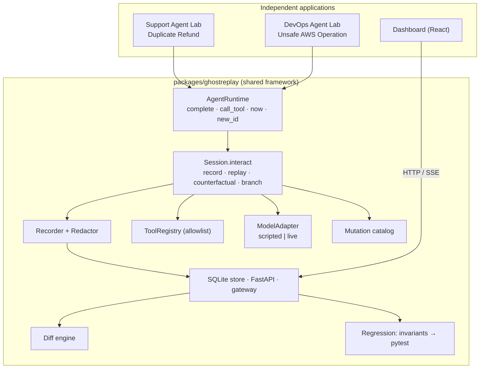
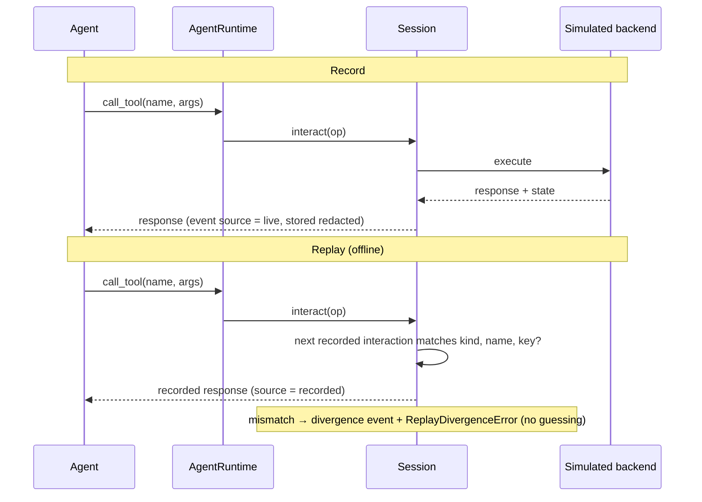

# Diagrams

Rendered versions live in [`assets/`](assets/): `architecture.svg` and
`record-replay-sequence.svg`. The Mermaid sources below render on GitHub and are the
canonical text versions.

## Architecture

## Record and replay

